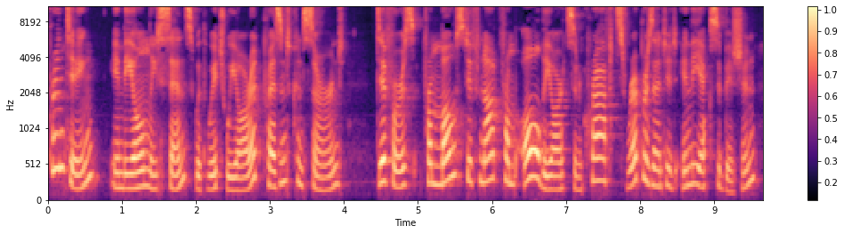

# AI Speech — Flip School

Speech-processing and recognition notebooks for **aispeech 풀잎스쿨**. Explore audio features, Korean text tokenization, and three speech-recognition approaches: CTC, attention-based LAS, and RNN Transducer.

[Start with audio](asr/spectrogram.ipynb) · [Explore the notebooks](#learning-path) · [Setup notes](docs/SETUP.md)



*An existing output from [spectrogram.ipynb](asr/spectrogram.ipynb), using the included `LJ001-0001.wav` recording.*

## Learning path

| Step | Notebook | What it covers |
| --- | --- | --- |
| 1 | [Spectrograms](asr/spectrogram.ipynb) | Waveform playback, STFT, FFT size and hop length, mel filter banks |
| 2 | [KsponSpeech preprocessing](asr/ksponspeech.ipynb) | Transcript cleanup, Hangul tokenization, dataset construction, padded batches |
| 3 | [CTC + LSTM](asr/ctc_lstm_kspon.ipynb) | Convolutional features, bidirectional LSTM, CTC loss, forward-alignment visualization |
| 4 | [Listen, Attend and Spell](asr/las_lstm_kspon.ipynb) | An encoder–decoder model with attention, inference, and beam search |
| 5 | [RNN Transducer](asr/transducer_lstm_kspon.ipynb) | Encoder, prediction network, joint network, and transducer loss |

## Start here

The spectrogram notebook uses the audio file already in `asr/`. Open it with the working directory set to that folder:

```sh
git clone https://github.com/scpark20/aispeech_flip.git
cd aispeech_flip/asr
jupyter notebook spectrogram.ipynb
```

The audio example uses **NumPy, Matplotlib, librosa, and IPython**. The recognition examples additionally use **PyTorch**, and the transducer requires **`warp_rnnt`**.

Training expects a local **KsponSpeech** dataset and a CUDA GPU. Dataset files and trained checkpoints are not included. Before running training cells, update the dataset path and checkpoint settings described in the [setup notes](docs/SETUP.md).

## Supporting code

- [dataset.py](asr/dataset.py) loads paired PCM audio and transcripts and builds padded batches.
- [jamo.py](asr/jamo.py) cleans Korean transcripts and converts text to and from Hangul tokens.
- [utils.py](asr/utils.py) provides training logs and checkpoint handling.

The notebooks retain their original code and saved outputs. Their metadata records Python 3.8.8; dependency versions are not pinned. The README figure is a saved output, not a newly trained result.
